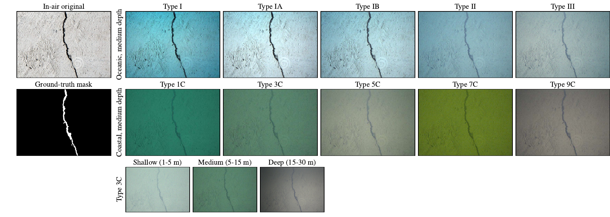
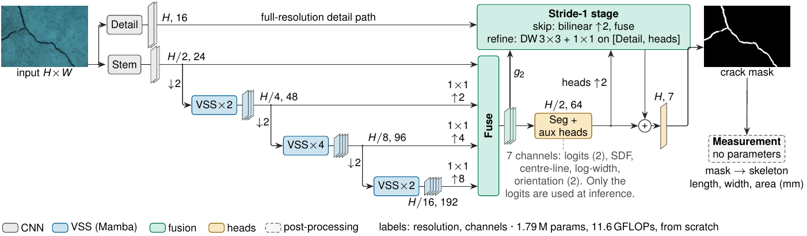
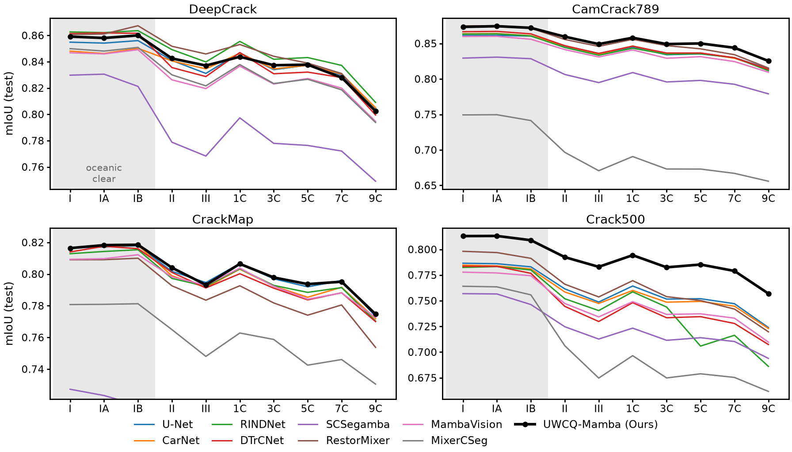
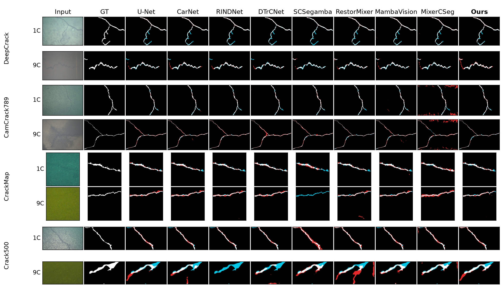

# UWCQ-Mamba and UWCQ-Bench

**Lightweight underwater crack segmentation and quantification.**

This repository holds:

- **UWCQ-Bench**, an underwater crack benchmark with measurement ground truth: four public crack datasets rendered
  under the ten Jerlov water types at three depths (144,420 images whose crack masks never move).
- **UWCQ-Mamba**, a 1.79 M-parameter encoder-decoder (11.58 GFLOPs at 512 x 512) that segments underwater cracks and
  measures six quantities from its mask: main and total length; minimum, mean and maximum width; area.
- The trained weights, the paper's result tables, per-image test results, figures and the report.

Paper: [`paper/UWCQ-Mamba_Report.pdf`](paper/UWCQ-Mamba_Report.pdf)



## Highlights

Nine models trained from scratch under one protocol on the four underwater test sets (Tables III to V of the paper):

- UWCQ-Mamba has the best ODS and OIS on all four datasets and the highest mIoU on three.
- It has the lowest average measurement error on three datasets (11.5 % on UW-CamCrack789, 12.7 % on UW-CrackMap,
  18.3 % on UW-Crack500).
- It has the fewest parameters (1.79 M), the fewest FLOPs (11.58 G) and the lowest GPU memory (90.3 MiB) of the nine.
- Its largest margin is on UW-Crack500: +0.029 mIoU, +0.053 ODS and +0.031 F1 over the next model.

## Repository layout

```
uwcq_mamba/              UWCQ-Mamba: model, selective scan, Triton inference kernels, losses, data, evaluation,
                         geometry (mask -> six quantities)
train.py                 training
evaluate.py              test-set evaluation (segmentation, per water type, measurement)
benchmark.py             inference latency
tests/test_exact.py      bit-identity of the fast inference against the plain model
configs/measure.yaml     measurement protocol
weights/                 trained UWCQ-Mamba weights, one per dataset (EMA, 7 MB each)
uwcq_bench/              UWCQ-Bench renderer (RSUIGM image formation, Jerlov coefficients, depth-to-distance)
generate_benchmark.py    regenerates UWCQ-Bench from the four public source datasets
benchmark/UW_*/          splits, measurement ground truth and summary of each dataset (images: see Download)
results/tables/          the paper's tables as CSV
results/uwcq_mamba/      UWCQ-Mamba per-image test results (segmentation and measurement) for each dataset
results/figures/         the paper's figures
paper/                   the report (PDF)
```

## UWCQ-Bench

Every source photograph is rendered under ten Jerlov water types (oceanic I, IA, IB, II, III and coastal 1C, 3C, 5C,
7C, 9C) at three depths (shallow 1-5 m, medium 5-15 m, deep 15-30 m): 30 renders per photograph. Image formation follows
RSUIGM, with the camera distance from Depth Anything V2, patchy turbidity, caustics, an ROV lamp, forward-scatter blur
and a simulated camera (noise, white balance, JPEG). No pixel moves, so all 30 renders of a photograph share its mask
and the same crack can be compared across water types.

| Dataset | Size (px) | Train | Val | Test | Renders |
|---|---|---:|---:|---:|---:|
| UW-DeepCrack | 544 x 384 | 360 | 68 | 109 | 16,110 |
| UW-CamCrack789 | 640 x 480 | 553 | 79 | 157 | 23,670 |
| UW-CrackMap | 256 x 256 | 84 | 12 | 24 | 3,600 |
| UW-Crack500 | 640 x 360 | 2,357 | 336 | 675 | 101,040 |
| **Total** | | 3,354 | 495 | 965 | 144,420 |

Counts are source photographs per split; each is rendered 30 times.

### Download

The rendered images (about 6.5 GB) are on Google Drive:
**https://drive.google.com/open?id=1HQNX0_20rt_W3JiD_ZttfZ3hW7xxRo7g**

| File | Size |
|---|---|
| `UW_DeepCrack.zip` | 571 MB |
| `UW_CamCrack789.zip` | 1.33 GB |
| `UW_CrackMap.zip` | 57 MB |
| `UW_Crack500.zip` | 4.53 GB |

Each zip holds one dataset folder:

```
UW_<dataset>/
  {train,val,test}_img/<source>_<jerlov>_<depth>.jpg     renders
  {train,val,test}_lab/<source>_<jerlov>_<depth>.png     crack masks (0/255), identical for all 30 renders of a source
  split_*.json                                            split files (source photographs per split)
  measurement_gt.csv / .json, measurement_gt_sources.csv, measurement_gt_components.csv
                                                          measurement ground truth (per render / source / crack)
  params.jsonl                                            every sampled rendering parameter, one line per render
  manifest.csv, summary.json, depth_fits.json             file list, counts, depth fits
  README.md                                               the dataset's own description
```

The split files, measurement ground truth (per source) and summaries are also in [`benchmark/`](benchmark).

Splits used in the paper:

| Dataset | Split file | Checkpoint selection |
|---|---|---|
| UW-DeepCrack | `split_group_7_1_2.json` (source-disjoint 7:1:2) | validation split |
| UW-CamCrack789 | `split_author_testsel.json` (authors' split) | authors' test split, as in the MixerCSeg protocol |
| UW-CrackMap | `split_author_testsel.json` (authors' split) | authors' test split, as in the MixerCSeg protocol |
| UW-Crack500 | `split_author_testsel.json` (authors' split) | authors' test split, as in the MixerCSeg protocol |

UW-DeepCrack's group split draws photographs from both original folders (`train_img`, `test_img`).

**Measurement ground truth.** Six quantities are measured from each ground-truth mask: main length (longest tip-to-tip
centreline path), total length (all branches), minimum, mean and maximum width (5th percentile, mean and 95th
percentile of 2-px width stations along the skeleton) and area. Each mask is measured in all 8 flips and quarter turns
and the median is kept (`*_px_cons` columns), which removes the skeleton's orientation sensitivity. Pixel values are
exact; the millimetre columns use one fixed camera scale (0.245 mm/px) for every set.

### Regenerate from the source datasets

`generate_benchmark.py` reproduces the renders exactly (checked byte for byte against the published files). Put the
original datasets in one folder (MixerCSeg layout: `<root>/<dataset>/{train,val,test}_img` and `_lab`) and run:

```
pip install pillow transformers            # transformers only for the depth stage
python generate_benchmark.py depth  --root /path/to/datasets --dataset CrackMap     # Depth Anything V2 (GPU)
python generate_benchmark.py render --root /path/to/datasets --dataset CrackMap --workers 10
python generate_benchmark.py index  --root /path/to/datasets --dataset CrackMap
```

The output goes to `<root>/UW_<dataset>`. Rendering is deterministic (seed 0).

### Source datasets

UWCQ-Bench is derived from four public datasets. The renders keep their masks and splits; please also cite the
original datasets and follow their terms of use:

- DeepCrack: Y. Liu et al., "DeepCrack: A deep hierarchical feature learning architecture for crack segmentation",
  Neurocomputing, 2019 ([github.com/yhlleo/DeepCrack](https://github.com/yhlleo/DeepCrack)).
- CamCrack789: G. Zhu et al., "A lightweight encoder-decoder network for automatic pavement crack detection",
  Computer-Aided Civil and Infrastructure Engineering, 2024.
- CrackMap: I. Katsamenis et al., "A few-shot attention recurrent residual U-Net for crack segmentation", ISVC 2023.
- Crack500: F. Yang et al., "Feature pyramid and hierarchical boosting network for pavement crack detection",
  IEEE T-ITS, 2020.

## UWCQ-Mamba



A stride-2 stem and two ConvNeXt blocks, a 16-channel stride-1 detail path, three visual state-space stages (strides
4, 8 and 16) whose blocks share one selective scan over eight raster routes, multi-scale fusion with a full-resolution
skip, and light heads. Auxiliary centreline, width, orientation and boundary-distance targets supervise training only;
at inference the mask is the argmax of the crack logits and a parameter-free step measures the six quantities.

### Setup

```
pip install -r requirements.txt
```

For full speed, build the selective-scan CUDA kernel from VMamba
(`git clone https://github.com/MzeroMiko/VMamba && cd VMamba/kernels/selective_scan && pip install .`), which provides
`selective_scan_cuda_oflex`. Without it the PyTorch scan in `uwcq_mamba/scan.py` is used: much slower, and its outputs
can differ slightly from the kernel's, so the numbers below and the bit-identity test need the kernel.

### Trained weights

| Dataset | Weights | Split file | `--calib-per-source` |
|---|---|---|---|
| UW-DeepCrack | `weights/uwdc.pth` | split_group_7_1_2.json | 1 |
| UW-CamCrack789 | `weights/uwcca.pth` | split_author_testsel.json | 1 |
| UW-CrackMap | `weights/uwcma.pth` | split_author_testsel.json | 3 |
| UW-Crack500 | `weights/uwc5a.pth` | split_author_testsel.json | 1 |

### Evaluate

```
python evaluate.py --data /path/UW_CrackMap --split split_author_testsel.json --weights weights/uwcma.pth --calib-per-source 3
```

Output for UW-CrackMap:

```
segmentation: {'mIoU': 0.8035, 'ODS': 0.7619, 'OIS': 0.7742, 'F1': 0.7481}
measurement error (%): {'L_m': 2.4, 'L_t': 3.9, 'W_min': 32.0, 'W_avg': 14.2, 'W_max': 12.7, 'A': 11.0, 'average': 12.7}
```

`evaluate.py` runs the fast inference; `--eager` runs the plain model, with the same results.

### Train

```
python train.py --data /path/UW_CamCrack789 --split split_author_testsel.json --out runs/uwcca
python train.py --data /path/UW_CrackMap --split split_author_testsel.json --crop 256 --out runs/uwcma
```

50 epochs of 402 optimizer steps (effective batch 8 = 4 x 2 accumulation), AdamW 1e-3 with warm-up and cosine decay,
mixed precision, EMA weights; `best.pth` is chosen on the split's selection photos. Training fits an 8 GB GPU.

### Use in code

```python
from uwcq_mamba.model import build_inference
from uwcq_mamba.evaluation import read_image, predict_mask, measure
import yaml

model = build_inference("weights/uwcca.pth", "cuda")             # or build(...).eval(): same results, slower
mask = predict_mask(model, read_image("crack.jpg"))              # (H, W) bool
cfg = yaml.safe_load(open("configs/measure.yaml"))
L_main, L_total, W_min, W_mean, W_max, area = measure(mask, cfg)  # mm with the configured scale
```

### Speed and memory

`build_inference(weights)` = `build` + `prepare_inference` (fp16 weights, Triton kernels for scan routing, LN2d and
residual updates, training-only node head dropped) + a CUDA graph per input shape. Under the inference protocol (fp16
autocast, no grad) its outputs are bit-identical to the trained model, checked on all 28,950 test renders of the four
datasets (`python tests/test_exact.py`).

RTX 5070 Laptop 8 GB, batch 1, fp16, median of 200 runs (`python benchmark.py --weights weights/uwcca.pth`):

| median ms / FPS | 512 x 512 | UW-DeepCrack 544 x 384 | UW-CamCrack789 480 x 640 | UW-CrackMap 256 x 256 | UW-Crack500 360 x 640 |
|---|---|---|---|---|---|
| `build(...).eval()` | 26.15 / 38.2 | 21.51 / 46.5 | 32.74 / 30.5 | 9.32 / 107.3 | 24.36 / 41.1 |
| `prepare_inference` | 14.67 / 68.2 | 13.69 / 73.0 | 18.31 / 54.6 | 12.42 / 80.5 | 14.44 / 69.3 |
| `build_inference` (CUDA graph) | **12.99 / 77.0** | **10.45 / 95.7** | **17.08 / 58.5** | **2.90 / 345.2** | **12.16 / 82.3** |

Table V of the paper measures all nine models with one shared protocol (each model in its own process, mean of two
passes), where UWCQ-Mamba runs at 68.0 FPS. Peak GPU memory of one 512 x 512 forward pass: 90.3 MiB.

## Results

All models trained from scratch for 50 epochs (one seed) under one protocol; MixerCSeg evaluation protocol and code.
CSV versions are in [`results/tables/`](results/tables).

### Segmentation (Table III)

| Method | DeepCrack mIoU | ODS | CamCrack789 mIoU | ODS | CrackMap mIoU | ODS | Crack500 mIoU | ODS |
|---|---|---|---|---|---|---|---|---|
| U-Net | 0.8384 | 0.7902 | 0.8359 | 0.8004 | **0.8038** | 0.7613 | 0.7314 | 0.6303 |
| CarNet | 0.8343 | 0.7883 | 0.8354 | 0.7993 | 0.8008 | 0.7571 | 0.7310 | 0.6323 |
| RINDNet | 0.8424 | 0.7985 | 0.8357 | 0.8000 | 0.7995 | 0.7547 | 0.7181 | 0.6020 |
| DTrCNet | 0.8381 | 0.7939 | 0.8382 | 0.8038 | 0.7997 | 0.7559 | 0.7185 | 0.6096 |
| SCSegamba | 0.8085 | 0.7462 | 0.8035 | 0.7527 | 0.6577 | 0.4906 | 0.7139 | 0.6049 |
| RestorMixer | 0.8419 | 0.7970 | 0.8458 | 0.8141 | 0.7904 | 0.7410 | 0.7362 | 0.6399 |
| MambaVision | 0.8319 | 0.7815 | 0.8307 | 0.7922 | 0.7988 | 0.7543 | 0.7201 | 0.6117 |
| MixerCSeg | 0.8288 | 0.7754 | 0.6987 | 0.5778 | 0.7655 | 0.7031 | 0.6918 | 0.5733 |
| **UWCQ-Mamba** | **0.8432** | **0.8005** | **0.8485** | **0.8188** | 0.8035 | **0.7619** | **0.7655** | **0.6927** |

OIS and F1 are in `results/tables/segmentation.csv`.

### Measurement (Table IV): average of the six median relative errors (%, lower is better)

| Method | DeepCrack | CamCrack789 | CrackMap | Crack500 |
|---|---|---|---|---|
| U-Net | 15.3 | 13.2 | 13.4 | 21.9 |
| CarNet | 13.6 | 12.7 | 13.6 | 22.0 |
| RINDNet | 13.7 | 13.0 | 13.1 | 23.6 |
| DTrCNet | 14.8 | 12.9 | 14.2 | 24.5 |
| SCSegamba | 18.8 | 17.0 | 46.5 | 30.0 |
| RestorMixer | **13.1** | 12.3 | 13.1 | 21.8 |
| MambaVision | 14.3 | 13.5 | 13.9 | 24.1 |
| MixerCSeg | 17.5 | 23.1 | 16.6 | 26.9 |
| **UWCQ-Mamba** | 13.5 | **11.5** | **12.7** | **18.3** |

All six quantities per dataset are in `results/tables/measurement_error_pct.csv`. Each model's scale for each quantity
is fitted on its own training images only.

### Cost (Table V): one 512 x 512 forward pass, RTX 5070 Laptop, batch 1, fp16

| Method | GFLOPs | Params (M) | Memory (MiB) | FPS |
|---|---:|---:|---:|---:|
| U-Net | 13.54 | 6.63 | 133.0 | **214.1** |
| CarNet | 21.08 | 4.91 | 91.7 | 195.4 |
| RINDNet | 311.58 | 59.39 | 1101.0 | 18.5 |
| DTrCNet | 86.79 | 65.46 | 387.5 | 34.5 |
| SCSegamba | 23.54 | 3.90 | 297.8 | 19.8 |
| RestorMixer | 111.03 | 3.20 | 585.3 | 9.9 |
| MambaVision | 47.33 | 32.66 | 267.6 | 53.8 |
| MixerCSeg | 41.97 | 2.54 | 177.2 | 44.0 |
| **UWCQ-Mamba** | **11.58** | **1.79** | **90.3** | 68.0 |

### Ablation of the auxiliary geometry targets (Table VI)

UW-DeepCrack selection split (61 source photographs, 305 renders), paired runs on one GPU; Delta = paired IoU loss
against the full model with its 95 % source-cluster bootstrap CI.

| Configuration | IoU | Delta [95 % CI] |
|---|---|---|
| Full model | 0.7121 | |
| w/o signed distance | 0.7118 | 0.0003 [-0.0041, 0.0045] |
| w/o centreline | 0.7038 | 0.0083 [0.0037, 0.0129] |
| w/o width | 0.7110 | 0.0011 [-0.0021, 0.0041] |
| w/o orientation | 0.7058 | 0.0062 [0.0012, 0.0116] |
| Full model (mean of two seeds) | 0.7122 | |
| w/o centreline + width + orientation | 0.6967 | 0.0155 [0.0088, 0.0227] |

Measurement errors for every row are in `results/tables/ablation_auxiliary_targets.csv`.

### Robustness across water types



### Qualitative results



Rows are the median-IoU test renders of UWCQ-Mamba for each dataset in Jerlov 1C and 9C (not selected by hand).
White: correct crack, red: false positive, cyan: missed crack.

### Per-image results

`results/uwcq_mamba/UW_<dataset>/per_image_segmentation.csv` lists, for every test render, its water type, depth,
crack IoU, Dice, clDice, precision, recall and boundary F1 (benchmark evaluator, per image).
`per_image_measurement.csv` lists the six quantities measured from UWCQ-Mamba's mask (px and mm) with validity flags.

## Citation

```bibtex
@misc{more2026uwcqmamba,
  title  = {{UWCQ-Mamba}: Lightweight Underwater Crack Segmentation and Quantification},
  author = {More, Parth Sadanand},
  year   = {2026},
  note   = {Project report, AR511 and AR522}
}
```

## License

Code and weights: MIT (see [LICENSE](LICENSE)). UWCQ-Bench renders are derived from the four source datasets above and
are provided for research use; their use is also subject to the terms of the original datasets.
